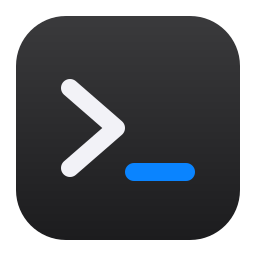

<p align="center"></p>

<h1 align="center">terminal-cowork</h1>

<p align="center">Claude Code and a real browser in one window, on Windows with WSL.</p>

You and Claude share the same browser. Claude opens pages, clicks, types and reads errors while you watch, and you can step in at any moment. Everything Claude makes appears right beside the chat.

## Features

- **Real terminal:** a full WSL terminal that starts Claude Code for you.
- **Several terminals:** add Claude Code sessions or plain shells from the sidebar. Each keeps running while you switch.
- **Agents board:** a Kanban view of every Claude Code session, with Ready, Working, Needs you and Done columns, the last prompt and what it is doing now. It runs on Claude Code's own hook events.
- **Real browser:** Chromium with tabs, logins that persist and popups that open as new tabs.
- **Shared control:** 12 MCP tools let Claude open pages, read them, click, type, scroll, take screenshots and read console and network errors. A `cowork` command does the same from any WSL shell.
- **Take control:** one button pauses Claude in the browser, for example during a login.
- **Point:** click any element on a page to send its selector, text, HTML and a screenshot to Claude.
- **Preview:** images, video, audio, PDF, Markdown, HTML, CSV, Excel, diffs and text. Previewable files Claude writes open by themselves.
- **macOS look:** a light design with sizes and colours measured from macOS 27 windows.

## Requirements

- Windows 11 with WSL2 and an Ubuntu distribution
- Node.js 22 or later inside WSL
- [Claude Code](https://code.claude.com) inside WSL
- For Excel previews: `python3` with `openpyxl`. For PDF previews: `pdftoppm`.

## Install

Run this inside WSL:

```sh
git clone https://github.com/leamariek/terminal-cowork.git
cd terminal-cowork
npm install
node scripts/vendor.mjs
node scripts/package-windows.mjs
```

Copy `dist/terminal-cowork-win32-x64` to `Apps\terminal-cowork` in your Windows user folder. Keep the cloned folder in WSL, because the app starts its backend from there.

Then link the command and open the app from any folder:

```sh
ln -sf "$PWD/bin/terminal-cowork.js" ~/.local/bin/terminal-cowork
terminal-cowork
```

The build is not code signed, so Windows SmartScreen may warn on first launch.

## Shortcuts

Inside the browser:

| Keys | Action |
| --- | --- |
| Ctrl+L | Go to the address bar |
| Ctrl+T | New tab |
| Ctrl+W | Close tab |
| Ctrl+Tab | Next tab |
| Ctrl+R | Reload |

Inside a terminal, Ctrl+Shift+T starts a new Claude Code session.

Appearance (bottom of the sidebar, or Ctrl+,) switches between Light and Glass. Glass puts a nature photo behind frosted panes, with a Liquid Glass slider from clear to tinted, eight wallpapers and Choose… for a picture of your own.

The Agents board shows every Claude Code session on the machine, including ones started outside the app (tmux, other terminals), read from Claude Code's own session records. Each card lists that session's background work: workflows, shells, monitors and agents, also the ones started by workflow agents.

After a restart or an update the app reopens its terminals in their folders: Claude Code sessions resume (one that was working is told to continue), and terminals that were attached to tmux reattach. Closing every terminal by hand starts clean next time.

Copy and paste in a terminal work like Windows Terminal: Ctrl+C copies selected text (without a selection it interrupts), Ctrl+Shift+C always copies, Ctrl+V, Ctrl+Shift+V and Shift+Insert paste, and right-click copies a selection or pastes. With a screenshot on the clipboard, Ctrl+V goes through to Claude Code, which attaches the image.

## How it works

```
terminal-cowork.exe (window, browser)  <-- stdin and stdout through wsl.exe -->  backend/server.js (terminal, agent socket)
```

- `app/` is the Electron window. It holds no terminal code, so no native module is built for Windows.
- `backend/` runs inside WSL. Claude reaches it over a private Unix socket, so the app opens no network port.
- `src/mcp.js`, `src/autopreview.js` and `skills/cowork/` are Claude's side. They are passed as launch flags, so your global Claude Code settings stay unchanged.
- The browser has its own profile, separate from your normal browser. Web pages get no camera, microphone or location access.
- Problems on startup are written to `%APPDATA%\terminal-cowork\backend.log`.

`src/pane.js`, `src/sixel.js`, `src/ptyproxy.py` and `tmux.conf` are a second variant that runs inside Windows Terminal with Sixel graphics, started with `cowork` in a terminal.

## Test

```sh
spikes/e2e/app-up.sh <scratch folder> &
python3 spikes/e2e/app-check.py <scratch folder>
python3 spikes/e2e/restore-check.py <scratch folder>   # starts its own instances
```

## Credits

Inspired by [terminal-mac](https://github.com/govijr/terminal-mac) and [terminal-browser](https://github.com/zenbu-labs/terminal-browser). Interface type is [Inter](https://rsms.me/inter/) and [JetBrains Mono](https://www.jetbrains.com/lp/mono/).

Wallpapers from Wikimedia Commons, each under its own license (the app's MIT license does not cover them):

- Lake Tahoe: [Lake Tahoe at morning - 7-2023.jpg](https://commons.wikimedia.org/wiki/File:Lake_Tahoe_at_morning_-_7-2023.jpg) by John D., CC BY 2.0
- Kungsleden: [Stuor Dáhtá lake along the Kungsleden trail during golden hour in Kvikkjokk-Kabla fjällurskog (DSCF2557).jpg](https://commons.wikimedia.org/wiki/File:Stuor_D%C3%A1ht%C3%A1_lake_along_the_Kungsleden_trail_during_golden_hour_in_Kvikkjokk-Kabla_fj%C3%A4llurskog_(DSCF2557).jpg) by Trougnouf (Benoit Brummer), CC BY 4.0
- Gokyo: [Gokyo Ri summit, Gokyo Lake, Nepal, Himalayas.jpg](https://commons.wikimedia.org/wiki/File:Gokyo_Ri_summit,_Gokyo_Lake,_Nepal,_Himalayas.jpg) by Vyacheslav Argenberg, CC BY 4.0
- Cerro Pachón: [Vera C Rubin Observatory in the Snow (IMG 0315-CC).jpg](https://commons.wikimedia.org/wiki/File:Vera_C_Rubin_Observatory_in_the_Snow_(IMG_0315-CC).jpg) by NOIRLab/NSF/AURA/C. Corco, CC BY 4.0
- Padar: [Padar Island, Komodo National Park, Indonesia, 20250822 0929 2659.jpg](https://commons.wikimedia.org/wiki/File:Padar_Island,_Komodo_National_Park,_Indonesia,_20250822_0929_2659.jpg) by Jakub Hałun, CC BY 4.0
- High Fens: [Bois Raquet, in the High Fens – Eifel Nature Park (DSCF6655).jpg](https://commons.wikimedia.org/wiki/File:Bois_Raquet,_in_the_High_Fens_%E2%80%93_Eifel_Nature_Park_(DSCF6655).jpg) by Trougnouf (Benoit Brummer), CC BY 4.0
- Frontignan: [Dike in Frontignan.jpg](https://commons.wikimedia.org/wiki/File:Dike_in_Frontignan.jpg) by Christian Ferrer, CC BY 4.0
- Salagou: [Lac du Salagou - October 2020.jpg](https://commons.wikimedia.org/wiki/File:Lac_du_Salagou_-_October_2020.jpg) by Christian Ferrer, CC BY 4.0

Not affiliated with Apple or Anthropic.

## License

[MIT](LICENSE)
